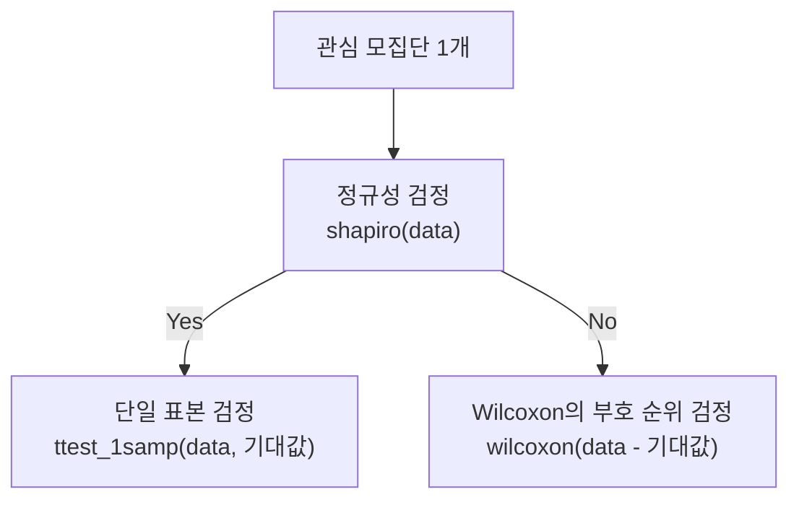
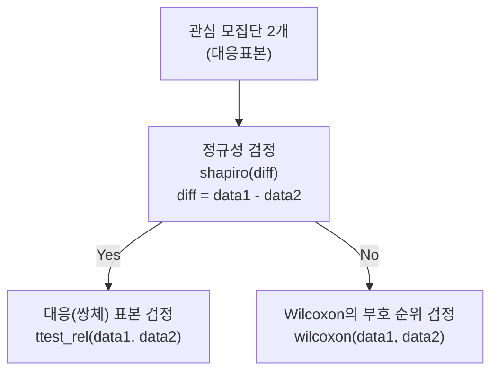
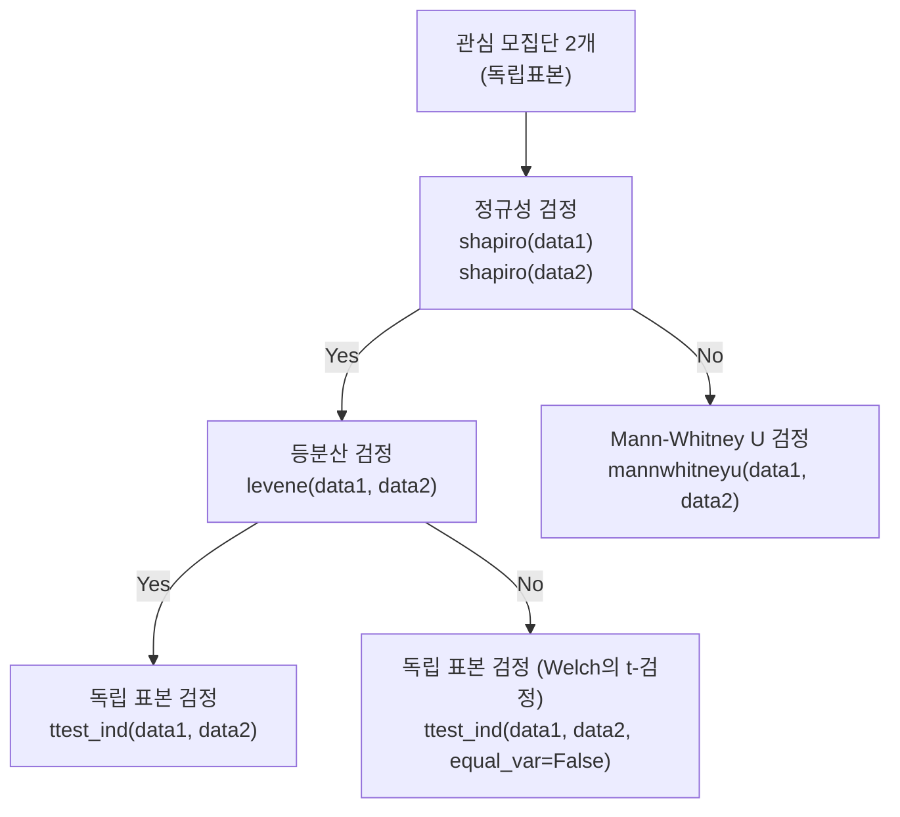

# 가설검정

## 모집단과 표본

- 모집단: 연구 대상이 되는 전체 집단
- 표본: 모집단의 일부

## 귀무가설과 대립가설

- 귀무가설: 기존에 알려진 사실, 효과나 차이가 없음
  - 퇴근후딴짓 강의 수강생과 타 강의 수강생의 합격률 차이가 없다
- 대립가설: 연구자가 입증하려는 사실, 효과나 차이가 있음
  - 퇴근후딴짓 강의 수강생은 타 강의 수강생보다 합격률이 높다

## 검정 결과

- 검정통계량: 주어진 데이터와 귀무가설 간의 차이를 통계적으로 나타내는 값
- p-value (유의수준 0.05)
  - 유의수준보다 작으면 **귀무가설을 기각**하고, 대립가설을 채택한다.
  - 유의수준보다 크면 귀무가설을 기각하지 못한다. **(귀무가설 채택)**

## 가설검정 프로세스

1. 통계적 가설 설정: 귀무가설과 대립가설
2. 유의수준 결정: 예) 0.05
3. 검정통계량 및 p-value(유의확률) 계산
4. 결과 도출

## t-test (t-검정)

| 구분 | 모집단 | 그룹 관계 | 예시 |
| --- | --- | --- | --- |
| 단일표본검정 | 모집단 1개 | 한 그룹 | 과자의 무게는 200g과 다른지 검정 |
| 대응(쌍체)표본검정 | 모집단 2개 (같은 집단) | 같은 그룹 | 신약 효과 (전후) 검정 |
| 독립표본검정 | 모집단 2개 | 서로 다른 그룹 | 1반과 2반의 성적 차이 검정 |

### 단일표본검정

### 대응표본검정

### 독립표본검정

