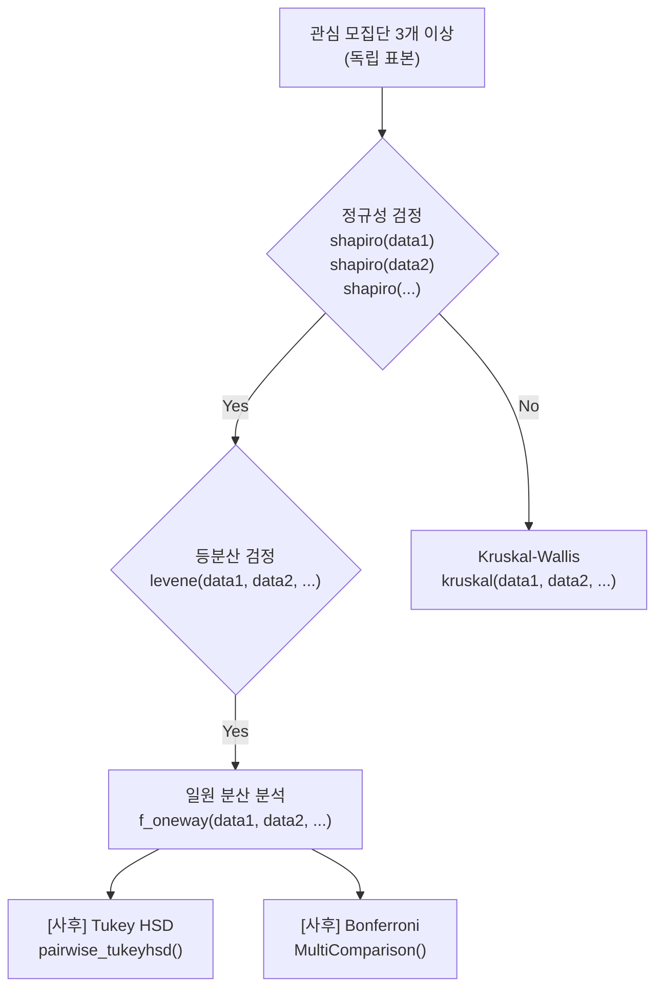
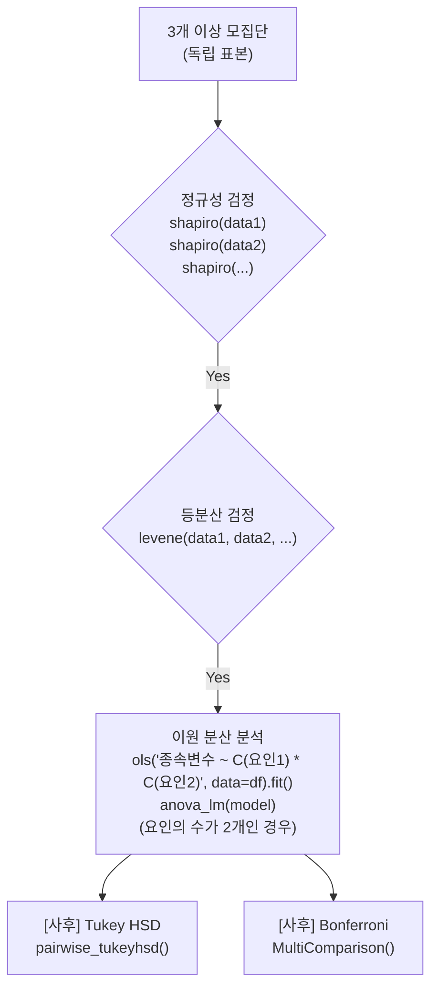

# 분산분석 (ANOVA)

분산분석(ANOVA)은 여러 집단의 평균 차이가 통계적으로 유의한지 검정하는 방법이다.

- 일원 분산 분석 (One-way ANOVA): 하나의 요인에 따른 평균의 차이 검정
- 이원 분산 분석 (Two-way ANOVA): 두 개의 요인에 따른 평균의 차이 검정

## 일원 분산 분석

- 3개 이상의 집단 간 평균 차이가 통계적으로 유의한지 검정
- 요인이 1개이고, 집단의 수가 3개 이상일 때 사용

### 기본 가정

- 독립성: 각 관측치는 서로 독립적이다.
- 정규성: 각 집단은 정규분포를 따른다. (샤피로 검정)
- 등분산성: 모든 집단은 동일한 분산을 가진다. (레빈 검정)

### 귀무가설과 대립가설

- 귀무가설: 모든 집단의 평균은 같다.
- 대립가설: 적어도 한 집단의 평균은 다르다.

### 일원 분산 분석

```python
# SciPy
f_oneway(sample1, sample2, ...)
```

```python
# statsmodels (ANOVA 테이블)
model = ols('종속변수 ~ 요인', data=df).fit()
print(anova_lm(model))
```

| 구분 | df | sum_sq | mean_sq | F | PR(>F) |
| --- | ---: | ---: | ---: | ---: | ---: |
| variable | 3.0 | 2.35875 | 0.78625 | 7.296984 | 0.000605 |
| Residual | 36.0 | 3.87900 | 0.10775 | NaN | NaN |

- `df`: 자유도
- `sum_sq`: 제곱합 (요인은 집단 간 제곱합, Residual은 잔차 제곱합)
- `mean_sq`: 평균 제곱 (`sum_sq / df`)
- `F`: 검정통계량
- `PR(>F)`: p-value

### 프로세스



#### 투키 (Tukey HSD)

| group1 | group2 | meandiff | p-adj | lower | upper | reject |
| --- | --- | ---: | ---: | ---: | ---: | --- |
| A | B | 0.41 | 0.0397 | 0.0146 | 0.8054 | True |
| A | C | 0.09 | 0.9273 | -0.3054 | 0.4854 | False |
| A | D | -0.27 | 0.2722 | -0.6654 | 0.1254 | False |
| B | C | -0.32 | 0.1483 | -0.7154 | 0.0754 | False |
| B | D | -0.68 | 0.0003 | -1.0754 | -0.2846 | True |
| C | D | -0.36 | 0.0852 | -0.7554 | 0.0354 | False |

#### 본페로니 (Bonferroni)

| group1 | group2 | stat | pval | pval_corr | reject |
| --- | --- | ---: | ---: | ---: | --- |
| A | B | -2.7199 | 0.014 | 0.0843 | False |
| A | C | -0.515 | 0.6128 | 1.0 | False |
| A | D | 1.7538 | 0.0965 | 0.5788 | False |
| B | C | 2.2975 | 0.0338 | 0.2028 | False |
| B | D | 6.0686 | 0.0 | 0.0001 | True |
| C | D | 2.5219 | 0.0213 | 0.1279 | False |

## 이원 분산 분석

- 여러 집단 간 평균 차이가 통계적으로 유의한지 검정
- 요인의 수가 2개일 때 사용

### 기본 가정

- 독립성: 각 관측치는 서로 독립적이다.
- 정규성: 각 집단은 정규분포를 따른다. (샤피로 검정)
- 등분산성: 모든 집단은 동일한 분산을 가진다. (레빈 검정)

### 귀무가설과 대립가설

주 효과와 상호작용 효과

- 주 효과 (요인1)
  - 귀무가설: 첫 번째 요인의 모든 수준에서 평균은 동일하다.
  - 대립가설: 첫 번째 요인의 수준 중 적어도 하나의 평균이 다르다.
- 주 효과 (요인2)
  - 귀무가설: 두 번째 요인의 모든 수준에서 평균은 동일하다.
  - 대립가설: 두 번째 요인의 수준 중 적어도 하나의 평균이 다르다.
- 상호작용 효과
  - 귀무가설: 두 요인 간에 상호작용이 없다.
  - 대립가설: 두 요인 간에 상호작용이 있다.

### 이원 분산 분석

```python
# statsmodels (ANOVA 테이블)
model = ols('종속변수 ~ C(요인1) * C(요인2)', data=df).fit()
print(anova_lm(model))
```

| 구분 | df | sum_sq | mean_sq | F | PR(>F) |
| --- | ---: | ---: | ---: | ---: | ---: |
| C(종자) | 3.0 | 4801.000000 | 1600.333333 | 18.757977 | 7.254117e-10 |
| C(비료) | 2.0 | 1140.316667 | 570.158333 | 6.682993 | 1.835039e-03 |
| C(종자):C(비료) | 6.0 | 725.350000 | 120.891667 | 1.417007 | 2.146636e-01 |
| Residual | 108.0 | 9214.000000 | 85.314815 | NaN | NaN |

### 프로세스



> 참고: 위 흐름도는 강의 자료에 제시된 분기만 옮겼다. 등분산 가정이 충족되지 않는 경우의 분기는 원본에 제시되지 않았다.
>
> 일원 분산 분석은 두 집단에도 적용할 수 있지만, 강의에서는 주로 세 집단 이상을 비교하는 경우를 다룬다. 이원 분산 분석의 구분 기준은 집단 수가 아니라 요인의 수(2개)이다.
